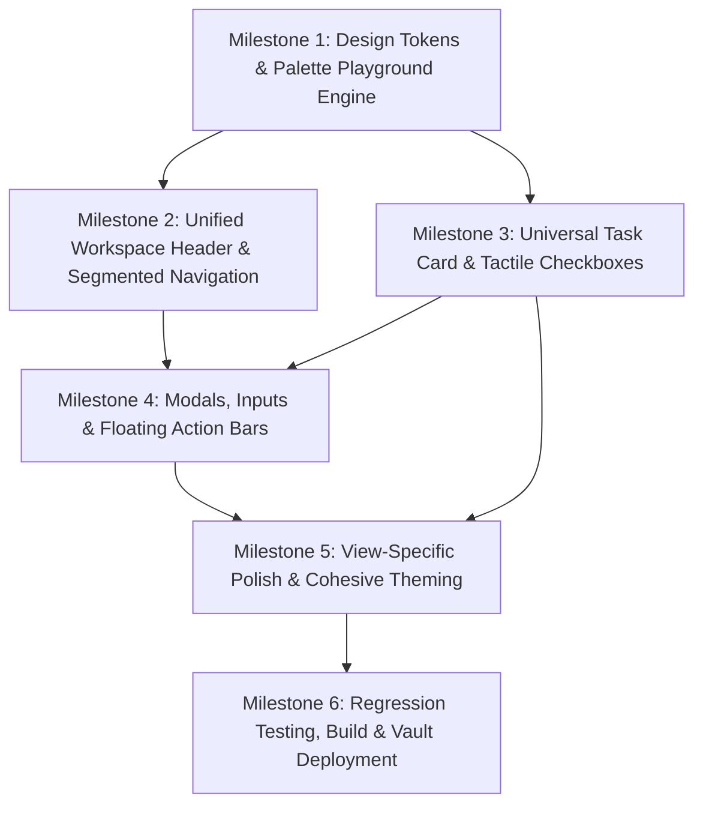

# Plan 011: Unified Design System, Palette Playground, and Modern UI Refresh

> Status: COMPLETE  
> Priority: P1  
> Effort: Large  
> Risk: Low (UI/UX and Style Refactoring with backwards-compatible selectors)  
> Planned: 2026-11-03  
> Completed: 2026-11-03  
> Depends on: Plans 001–010, existing views, and cache/mutation infrastructure  
> Design Inspiration: [Dribbble 26349883 (To-Do App Palette Playground)](https://dribbble.com/shots/26349883-To-Do-App-Palette-Playground) & [Dribbble 26171921 (To-do Productivity App)](https://dribbble.com/shots/26171921-To-do-Productivity-App)

---

## 1. Goal & Vision

Transform **TickTick Bridge** from a collection of separately developed views into a **cohesive, world-class productivity operating system** inside Obsidian.

Drawing inspiration from the two reference Dribbble designs:
1. **Palette Playground (Dribbble 26349883)**:
   - Introduce an intentional, vibrant, and accessible color system: soft tinted tonal card surfaces (`tint-bg`), crisp colored borders, and multi-tone category/priority badges, replacing monotone dark grey surfaces.
   - Dynamic theme-adaptive lightness/darkness variables that integrate seamlessly with any Obsidian theme (Minimal, AnuPpuccin, CyberGlow, Default Dark/Light).
2. **Modern Productivity App Experience (Dribbble 26171921)**:
   - **Unified Workspace Header & Navigation**: A sleek top segmented control (`[کانبان | تقویم | آیزنهاور | زمان‌بندی | تایم‌لاین | مرور هفتگی | هیت‌مپ]`) allowing instantaneous switching between views without opening the command palette.
   - **Universal Task Card Anatomy**: A standardized, tactile task card structure across all 8 views (custom animated spring checkboxes, title typography, relative due chips, tag badges, and smooth hover micro-actions).
   - **Spatial Consistency & Polish**: Unified 4px/8px spacing grid, rounded corner scale (10px–18px), glassmorphic elevation overlays, and clean Persian typography.

---

## 2. Deep Design Audit & Gap Analysis

| Area | Current State in Codebase | Identified Issues | Target Architecture (Plan 011) |
| :--- | :--- | :--- | :--- |
| **CSS Tokens & Units** | `tokens.css` has basic tokens, but views use mixed units (`rem` in board/calendar vs `px` in matrix/timeblocking/review). | Inconsistent font sizes, margins, and border radii across views when zooming or changing themes. | Unified 4px/8px scale, standard radii scale (`--tb-radius-card: 12px`, `--tb-radius-modal: 18px`, `--tb-radius-pill: 9999px`). |
| **Navigation & Header** | Each view (`project-board`, `eisenhower-matrix`, `timeblocking`, `weekly-review`, `heatmap`) builds its own isolated toolbar. | No cross-view navigation; user cannot switch between Kanban, Matrix, or Agenda without running Obsidian commands. | **Unified Workspace Header** with Segmented Tab Pill Control, Global Quick Add (`+`), Search/Filter toggle, and Sync button. |
| **Task Card Architecture** | 8 separate task card implementations with diverging DOM and styles. | Mismatched paddings, divergent hover animations (`translateY` vs none), inconsistent checkboxes, and scattered metadata badge layouts. | **Universal Task Card Anatomy**: standard `.tb-task-card` with tactile animated checkbox, relative date chip, project pill, and hover actions. |
| **Color & Palette Playground** | Static colors (`#ef4444`, `#f59e0b`, `#3b82f6`); flat grey backgrounds with disparate `color-mix` opacities. | Views feel either monotonous or visually disconnected. Harsh contrast in light themes. | **Palette Playground Token Engine**: soft pastel tinted card backgrounds, radiant priority borders, and harmonious category badges. |
| **Modals & Dialogs** | Modals (`QuickCapture`, `MorningBriefing`, `TaskDetails`, `BulkActionBar`) use differing widths, border radii, and button styles. | Inconsistent backdrop blurs, input focus rings, and button placement. | Standardized modal container, glassmorphism backdrop blur (`16px`), uniform input styling, and clear action button hierarchy. |
| **Persian Typography & RTL** | `direction: rtl` exists, but several files use hardcoded `left`/`right` properties. | Minor layout glitches in nested elements, non-standard line-heights. | Strict CSS logical properties (`margin-inline`, `padding-inline`, `inset-inline`), refined Vazirmatn/Shabnam font scale. |

---

## 3. Milestones & Implementation Roadmap

---

### Milestone 1: Design Tokens & Palette Playground Engine
**Files to update/create**:
- `src/styles/tokens.css` (Major overhaul)
- `src/styles/palette-playground.css` (New semantic palette rules)

1. **Spatial & Radii Scale**:
   - Spacing: `--tb-space-1: 4px`, `--tb-space-2: 8px`, `--tb-space-3: 12px`, `--tb-space-4: 16px`, `--tb-space-5: 20px`, `--tb-space-6: 24px`, `--tb-space-8: 32px`.
   - Radii: `--tb-radius-xs: 4px`, `--tb-radius-s: 6px`, `--tb-radius-m: 10px`, `--tb-radius-l: 14px`, `--tb-radius-xl: 18px`, `--tb-radius-pill: 9999px`.
2. **Palette Playground Tones (Dribbble 26349883)**:
   - High Priority (Q1 / Urgent): Coral Rose (`#f43f5e`), soft tint background `rgba(244, 63, 94, 0.07)`, border `rgba(244, 63, 94, 0.22)`.
   - Medium Priority (Q2 / Important): Warm Amber (`#f59e0b`), soft tint background `rgba(245, 158, 11, 0.07)`, border `rgba(245, 158, 11, 0.22)`.
   - Low Priority (Q3 / Low): Electric Indigo (`#3b82f6`), soft tint background `rgba(59, 130, 246, 0.07)`, border `rgba(59, 130, 246, 0.22)`.
   - Routine / None (Q4): Muted Slate (`#64748b`), neutral surface.
   - Completed / Success: Mint Green (`#10b981`).
   - Focus / Pomodoro: Radiant Cyan (`#06b6d4`).
   - Notes / Ideas: Royal Orchid (`#8b5cf6`).
3. **Elevations & Glassmorphism**:
   - Flat Surface: `var(--background-secondary)` with subtle 1px border.
   - Raised Card: `0 2px 8px rgba(0, 0, 0, 0.05), 0 1px 2px rgba(0, 0, 0, 0.03)`.
   - Hover Card: `0 8px 24px color-mix(in srgb, var(--card-accent, var(--interactive-accent)) 15%, transparent), 0 2px 6px rgba(0, 0, 0, 0.04)`, `transform: translateY(-2px)`.
   - Floating Bars & Modals: `backdrop-filter: blur(16px)`, `box-shadow: 0 16px 40px rgba(0, 0, 0, 0.3)`.

---

### Milestone 2: Unified Workspace Header & Segmented Navigation
**Files to update/create**:
- `src/obsidian/components/workspace-header.ts` (New shared component)
- `src/styles/workspace-header.css` (New styling)
- Integration into:
  - `src/obsidian/project-board.ts`
  - `src/obsidian/planning-calendar.ts`
  - `src/obsidian/eisenhower-matrix.ts`
  - `src/obsidian/timeblocking-planner.ts`
  - `src/obsidian/project-timeline.ts`
  - `src/obsidian/weekly-review.ts`
  - `src/obsidian/activity-heatmap.ts`

1. **Segmented Tab Switcher**:
   - Clean horizontal pill switcher at the top of each view:
     `[ 📋 کانبان | 📅 تقویم | 🎯 آیزنهاور | ⏱️ زمان‌بندی | 📊 تایم‌لاین | 🔍 مرور هفتگی | 🔥 نقشه فعالیت ]`
   - Active view tab receives smooth background pill with subtle accent glow.
   - Switching tabs smoothly replaces the view in the active workspace leaf without spawning duplicate panes.
2. **Unified Action Controls (Right/Left in RTL)**:
   - Quick Add Task Button (`+ تسک جدید` with accent styling).
   - Morning Briefing Icon Button (`🌅`).
   - Filter & Search Toggle Button (`🔍`).
   - Sync Now Button (`🔄` with smooth spinning animation during synchronization).
   - View-specific controls (e.g. date picker in Calendar/Timeblocking, Grouping in Board).

---

### Milestone 3: Universal Task Card & Tactile Checkboxes
**Files to update/create**:
- `src/obsidian/components/task-card-element.ts` (Unified task card builder)
- `src/styles/task-card.css` (Unified card styling)

1. **Tactile Spring Checkbox**:
   - Modern rounded-squircle or circular checkbox (`width: 18px; height: 18px`).
   - Click triggers a delightful micro-bounce animation (`scale(0.85)` -> `scale(1.15)` -> `scale(1.0)`).
   - Animated SVG checkmark path drawn with `stroke-dashoffset`.
2. **Unified Metadata Chips**:
   - Due Date Chip: Smart relative text ("امروز", "فردا", "دیروز / معوق") with urgent red tint when overdue, green when today, muted when upcoming.
   - Project Chip: Project dot color + project name.
   - Tag Pills: Subtly tinted tags (`#کار`, `#مطالعه`).
   - Checklist / Subtask Indicator: Progress ring or ratio pill (e.g., `✓ 3/5`).
   - Pomodoro Badge: `🍅 2` for estimated sessions.
3. **Hover Action Bar (Zero-Layout Shift)**:
   - Action icons smoothly fade in on card hover:
     - 🍅 شروع پومودورو (Start Focus)
     - ✏️ ویرایش سریع (Edit Modal)
     - 📅 زمان‌بندی (Schedule picker)
     - ⋯ گزینه‌های بیشتر (Context Menu)

---

### Milestone 4: Modernizing Modals, Inputs & Floating Action Bars
**Files to update/create**:
- `src/styles/modals.css` (Refactor and unify)
- `src/styles/quick-capture.css`
- `src/styles/morning-briefing.css`
- `src/obsidian/bulk-action-bar.ts`

1. **Modal Architecture**:
   - Unified backdrop: `backdrop-filter: blur(16px); background: rgba(0, 0, 0, 0.45);`.
   - Modal Shell: `border-radius: var(--tb-radius-xl, 18px); border: 1px solid rgba(255, 255, 255, 0.08);`.
   - Header: Integrated title, badge, and close button in RTL corner.
2. **Unified Input & Button Hierarchy**:
   - Modern input fields: Rounded 10px, subtle background, accent border on focus with glowing ring (`box-shadow: 0 0 0 3px color-mix(in srgb, var(--interactive-accent) 20%, transparent)`).
   - Button styles:
     - Primary: Filled accent button with crisp text.
     - Secondary: Subtle outline button with hover fill.
     - Ghost: Transparent icon button with rounded hover pill.
3. **Floating Bulk Action Bar**:
   - Centered floating bottom pill with counter, grouped buttons (پروژه، تگ، اولویت، تعویق، حذف), and dismiss button.

---

### Milestone 5: View-Specific Polish & Cohesive Theming
**Files to update**:
- `src/styles/board.css`
- `src/styles/calendar.css`
- `src/styles/eisenhower-matrix.css`
- `src/styles/timeblocking-planner.css`
- `src/styles/timeline.css`
- `src/styles/weekly-review.css`
- `src/styles/activity-heatmap.css`
- `src/styles/query-block.css`

1. **Board (Kanban)**: Modern column containers with clean counter pills, smooth drag-over highlights, and empty state illustrations.
2. **Calendar**: Clean grid borders, active today header highlight, and streamlined multi-day event bars.
3. **Eisenhower Matrix**: Quadrant containers styled with Palette Playground pastel tints (Q1 Coral, Q2 Amber, Q3 Blue, Q4 Slate).
4. **Timeblocking Agenda**: Clean vertical time ruler, live time indicator line with pulsing dot, and cohesive backlog drawer.
5. **Timeline (Gantt)**: Rounded bar ends, milestone diamonds, and clean group collapsible rows.
6. **Weekly Review**: Hero metric cards with gradient headers, clean completion rings, and grouped victory lists.
7. **Activity Heatmap**: Standardized square cells, smooth 5-level green/accent tint scale, and Persian day/month labels.
8. **Query Block**: Clean in-markdown cards that blend seamlessly with user notes.

---

### Milestone 6: Verification, Visual Regression & Vault Deployment
1. **Automated Testing**:
   - Run complete unit test suite (`npm test`) to verify all 150+ tests continue to pass.
   - Ensure zero regressions in cache, mutations, or core business logic.
2. **Type Checking & Build**:
   - Run `npx tsc --noEmit` (0 errors).
   - Run `npm run build` to compile `main.js` and `styles.css`.
3. **Vault Deployment**:
   - Deploy build artifacts to `E:\puria\Obsidian Vault\.obsidian\plugins\ticktick-bridge`.
   - Verify visual rendering across dark and light modes.
