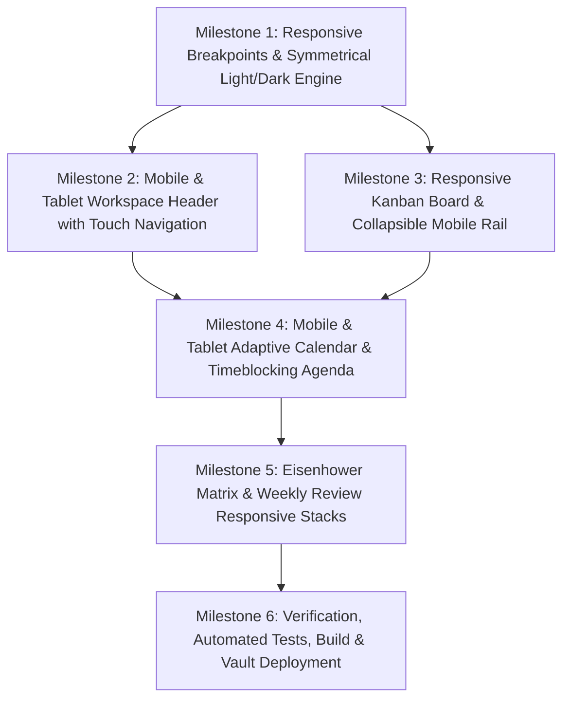

# Plan 012: Multi-Device Responsive System, macOS/Todoist Polish & Modern Dashboard Redesign

> Status: COMPLETE  
> Priority: P1  
> Effort: Large  
> Risk: Low (CSS & responsive UI enhancements, container queries, touch optimization)  
> Planned: 2026-11-03  
> Completed: 2026-11-03  
> Depends on: Plans 001–011, existing views and cache infrastructure  
> Design Inspiration:
> 1. [Dribbble 23079527 (TimeSwift - Timesheet)](https://dribbble.com/shots/23079527-TimeSwift-Timesheet) — Refined time tracking, timeline markers, clean stats counters
> 2. [Dribbble 23803120 (Todoist App for macOS)](https://dribbble.com/shots/23803120-Todoist-App-for-macOS-Figma-Freebie) — Native macOS minimalism, subtle borders, distraction-free cards
> 3. [Dribbble 27856359 (Task Management App - Daily Planner)](https://dribbble.com/shots/27856359-Task-Management-App-Productivity-Dashboard-Daily-Planner) — Mobile task planner, touch targets, daily agenda, bottom sheet
> 4. [Dribbble 21325062 (Task Management Dashboard - Light & Dark Theme)](https://dribbble.com/shots/21325062-Task-Management-Dashboard-Light-and-dark-theme) — Symmetrical high-contrast dark & light themes, modern segmented tabs

---

## 1. Executive Summary & Vision

Building on Plan 011's design token foundation, this plan elevates **TickTick Bridge** into an ultra-responsive, cross-device application that performs effortlessly on:
- **Mobile Phones** (portrait & landscape, 320px–480px)
- **Tablets & Foldables** (iPads, Android tablets, 600px–900px)
- **Narrow Obsidian Split Panes & Sidebars** (280px–420px)
- **Desktop Ultrawide & Laptops** (1024px–1920px+)
- **Both Obsidian Dark and Light Modes** with rich contrast and cohesive palette tints.

---

## 2. Key Deficiencies & Architectural Improvements

| Area | Current State | Issues on Mobile / Small Screens | Target Architecture (Plan 012) |
| :--- | :--- | :--- | :--- |
| **Workspace Header** | 7 tabs with text and icons in a single row. | On screens < 650px, tabs overflow or squeeze; buttons can be clipped. | Responsive **Collapsible Tab Rail**: shows active tab label + icon pills, horizontal smooth scroll with snap, touch-friendly 44px tap targets. |
| **Calendar (Day/Week/Month)** | 7 fixed day columns (`min-width: 56rem`). | Squeezes or requires manual wide horizontal scrolling on phone screens. | **Adaptive View Scaling**: on mobile (< 640px), auto-optimizes to 1-Day or swipeable 3-Day view, or compact list agenda with smooth day indicator chips. |
| **Eisenhower Matrix** | 2x2 grid (`1fr 1fr`). | Becomes tiny 140px boxes on mobile; tasks are truncated. | **Responsive Quadrant Stack / Segmented Switcher**: collapses into a clean 1-column accordion or swipeable pill tabs (`[فوری و مهم \| برنامه‌ریزی \| تفویض \| حذف]`) on screens < 768px. |
| **Kanban Board** | Rail sidebar (15.5rem) + horizontal columns. | Consumes 50% of the screen on tablets; cramps columns. | **Drawer Rail with Touch Toggle**: collapsable floating drawer or bottom sheet for project selection on mobile/tablet. |
| **Timeblocking Agenda** | Side-by-side time grid and backlog. | Too cramped on portrait mobile screens. | **Vertical Streamlining**: Full-width time ruler with quick floating backlog pill drawer. |
| **Touch Targets & Gestures** | Some buttons are 28px–32px without tap padding. | Difficult to tap with thumbs on mobile devices. | **44px Minimum Touch Targets** via invisible pseudo-element tap zones (`::after`). |
| **Theme Contrast (Dark & Light)** | Some tints were tailored primarily for dark theme. | Light theme cards can appear low-contrast or washed out. | **Symmetrical High-Contrast Theme Engine** (Dribbble 21325062): deep rich surfaces in dark mode, crisp porcelain with soft tinted shadows in light mode. |

---

## 3. Milestones & Implementation Roadmap

---

### Milestone 1: Responsive Breakpoints & Symmetrical Light/Dark Engine
- Refine `src/styles/tokens.css` with standard media and container query breakpoints:
  - `--tb-break-mobile: 480px`
  - `--tb-break-tablet: 768px`
  - `--tb-break-laptop: 1024px`
- Standardize touch target utility (`.tb-touch-target`) ensuring 44px min tap area.
- Enhance light mode color-mix contrasts in `src/styles/palette-playground.css` inspired by Dribbble 21325062:
  - Dark mode: rich dark charcoal/slate backgrounds, vibrant neon pastel accents.
  - Light mode: crisp porcelain card backgrounds, deep legible text (`#1a1f2c`), and soft warm borders (`rgba(0,0,0,0.08)`).

### Milestone 2: Mobile & Tablet Workspace Header with Touch Navigation
- Refactor `src/styles/workspace-header.css`:
  - Touch-friendly horizontal scroll snap for navigation tabs on screens < 768px.
  - On screens < 540px, show active tab label with icon, and icon-only for inactive tabs, keeping all 7 tabs instantly reachable in a sleek, non-wrapping bar.
  - Quick Add CTA expands on tap, with 44px tap zone for mobile thumbs.

### Milestone 3: Responsive Kanban Board & Collapsible Mobile Rail
- Update `src/styles/board.css` and `project-board.ts`:
  - On screens < 900px, project rail auto-collapses into a floating drawer or top pill selector.
  - Kanban columns enable native horizontal touch swipe (`scroll-snap-type: x mandatory`).
  - Column cards touch drag-and-drop feedback with haptic micro-scaling.

### Milestone 4: Mobile & Tablet Adaptive Calendar & Timeblocking Agenda
- Update `src/styles/calendar.css` and `src/styles/timeblocking-planner.css`:
  - In Weekly view on mobile (< 640px), day columns collapse to scrollable swipe cards with high-contrast day selector chips.
  - Timeblocking vertical ruler auto-adjusts hour intervals and features a slide-up backlog sheet.
  - Controls bar adapts cleanly into two compact rows on narrow mobile viewports.

### Milestone 5: Eisenhower Matrix & Weekly Review Responsive Stacks
- Update `src/styles/eisenhower-matrix.css` and `src/styles/weekly-review.css`:
  - On screens < 768px, matrix quadrants switch to an elegant tabbed pill selector (`[Q1 | Q2 | Q3 | Q4]`) or full-width stacked cards.
  - Weekly review metric cards adapt from 4-column to 2x2 grid on tablet, and single column on mobile.
  - Timeline Gantt view features touch pan and zoom controls.

### Milestone 6: Verification, Automated Tests, Build & Vault Deployment
- Execute complete test suite (`npm test` — all 150+ tests pass).
- TypeScript check (`npx tsc --noEmit` — 0 errors).
- Compile production bundles (`main.js`, `styles.css`).
- Deploy directly to `E:\puria\Obsidian Vault\.obsidian\plugins\ticktick-bridge\`.
