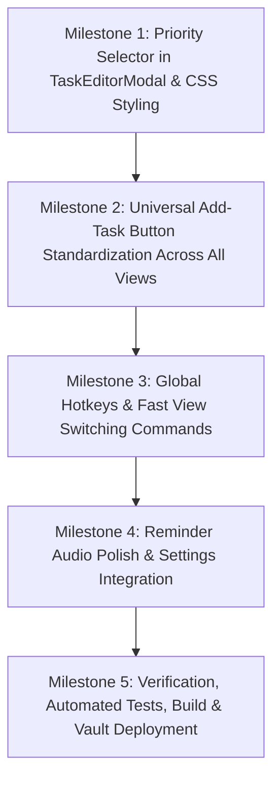

# Plan 013: Unified Task Modal Priority Selector, Universal Add-Task Button System & Workspace Hotkeys

> Status: COMPLETE  
> Priority: P1  
> Effort: Medium  
> Risk: Low (UI consistency, modal enhancements, command registrations)  
> Planned: 2026-11-03  
> Depends on: Plans 001–012, existing modals and views  

---

## 1. Executive Summary & Vision

Building upon the successful completion of Plans 001–012, this plan addresses the critical usability requirements identified by the user:
1. **Interactive Priority Selector in Task Modal**: Elevating `TaskEditorModal` with a 4-level color-coded tactile priority picker (`0: بدون اولویت`, `1: کم`, `3: متوسط`, `5: بالا`), supporting pre-selection from initial context and persisting `priority` to TickTick.
2. **Universal "Add Task" Button Architecture**: Standardizing every single "افزودن تسک" button across all views (Workspace Header, Calendar, Kanban, Eisenhower Matrix, Timeblocking, Today Panel, and Ribbon Menu) into a unified visual design system component (`.tb-action-add-task`) sharing identical 32px pill dimensions, accent color, typography, glowing hover states, and direct routing to the unified modal.
3. **Workspace Hotkeys & Fast Navigation Commands**: Registering dedicated Obsidian commands with hotkey recommendations for opening the task modal (`Alt+N`), quick NLP capture (`Alt+Shift+N`), and fast-switching between the 7 primary workspace views.
4. **Reminder & Timer Audio Polish**: Supporting audible alert settings for Pomodoro breaks and near-term task due notices.

---

## 2. Milestones & Implementation Roadmap

---

### Milestone 1: Priority Selector in TaskEditorModal & CSS Styling
- Extend `src/obsidian/modals/task-editor-modal.ts`:
  - Add interactive Priority selection row with 4 distinct chips:
    - `⚪ بدون اولویت` (Priority 0)
    - `🔵 کم` (Priority 1)
    - `🟠 متوسط` (Priority 3)
    - `🔴 بالا` (Priority 5)
  - Pre-populate based on `this.initial.priority` (e.g. from Eisenhower Q1 pre-selects 5, from Q3 pre-selects 1).
  - Include `priority` in the result payload passed to `finish()`.
- Add responsive styling in `src/styles/modals.css`:
  - Tactile pill buttons with subtle borders, active colored backgrounds, and soft glow effects matching theme tokens.

### Milestone 2: Universal Add-Task Button Standardization Across All Views
- Standardize the CSS class `.tb-action-add-task` in `src/styles/tokens.css` / `workspace-header.css`:
  - Height: 32px
  - Padding: `0 14px`
  - Border radius: `var(--tb-radius-pill, 9999px)`
  - Background: `var(--interactive-accent)`
  - Text color: `var(--text-on-accent)`
  - Font: `12px; font-weight: 700;`
  - Icon: `plus` (14x14px)
  - Uniform label: `+ تسک جدید`
  - Subtle glow shadow & smooth hover lift.
- Apply universally across:
  - `workspace-header.ts`
  - `planning-calendar.ts`
  - `project-board.ts`
  - `eisenhower-matrix.ts`
  - `timeblocking-planner.ts`
  - `main.ts` (Today view)
  - Ensure all primary buttons invoke `createTaskFromSurface(initial)`.

### Milestone 3: Global Hotkeys & Fast View Switching Commands
- Register Obsidian commands in `src/obsidian/main.ts`:
  - `open-task-editor`: "افزودن تسک جدید (Add task modal)"
  - `quick-capture-task`: "ثبت سریع تسک با زبان طبیعی (Quick capture NLP)"
  - `open-workspace-board`: "نمای کانبان (Open Kanban Board)"
  - `open-workspace-planner`: "نمای تقویم (Open Calendar)"
  - `open-workspace-matrix`: "نمای ماتریس آیزنهاور (Open Eisenhower Matrix)"
  - `open-workspace-timeblock`: "نمای زمان‌بندی روزانه (Open Timeblocking)"
  - `open-workspace-timeline`: "نمای تایم‌لاین و گانت (Open Timeline)"
  - `open-workspace-review`: "نمای مرور هفتگی (Open Weekly Review)"
  - `open-workspace-heatmap`: "نمای نقشه فعالیت (Open Activity Heatmap)"

### Milestone 4: Reminder Audio Polish & Settings Integration
- Add settings toggle and chime test button in `src/obsidian/settings.ts` for reminder & pomodoro sounds.

### Milestone 5: Verification, Automated Tests, Build & Vault Deployment
- Verify all unit tests (`npm test` — 150+ tests passing).
- Run TypeScript typecheck (`npx tsc --noEmit` — 0 errors).
- Compile production bundles (`styles.css`, `main.js`).
- Deploy directly to active vault: `E:\puria\Obsidian Vault\.obsidian\plugins\ticktick-bridge\`.
