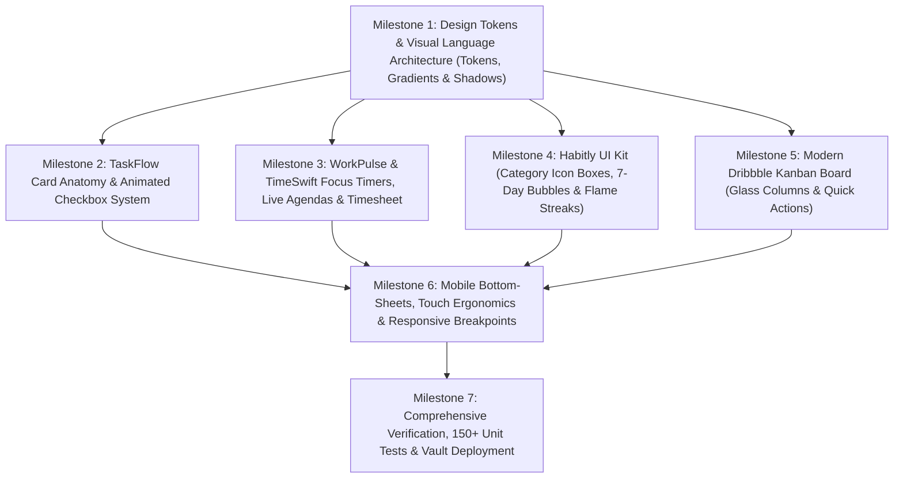

# Plan 014: Modern Dribbble Productivity Design System (TaskFlow, WorkPulse, TimeSwift, Habitly & Kanban)

> Status: IN PROGRESS  
> Priority: P1  
> Effort: Large  
> Risk: Low (Comprehensive UI/UX elevation, token harmonization, responsive mobile polish)  
> Planned: 2026-11-03  
> Depends on: Plans 001–013, existing views and CSS tokens  

---

## 1. Executive Summary & Design Vision

This plan elevates the entire TickTick Bridge Obsidian plugin into a world-class, premium productivity workspace inspired by 6 top-tier Dribbble design references provided by the user:

1. **[TaskFlow — Smart Task Management](https://dribbble.com/shots/27759037-TaskFlow-Smart-Task-Management-To-Do-List-App)**:
   - Bento-box card hierarchy and clean modular layout.
   - Tactile animated round-rect checkboxes with spring pop feedback.
   - Color-coded priority badges with subtle glowing dots (`🔴 بالا`, `🟠 متوسط`, `🔵 کم`).
   - Micro checklist progress chips (`☑ 2/5`) and time estimates (`⏱ 45m`).
2. **[WorkPulse — Time Tracker](https://dribbble.com/shots/23147717-WorkPulse-Time-Tracker)**:
   - Live focus indicator with pulsing radar rings (`● زمان تمرکز عمیق`).
   - High-contrast digital clock face with tabular numerals and subtle backdrop glow.
   - Active task session card with real-time progress bar.
   - Ergonomic pill buttons for timer controls (Start, Pause, Reset, Skip).
3. **[TimeSwift — Timesheet & Planning](https://dribbble.com/shots/23079527-TimeSwift-Timesheet)**:
   - Modern horizontal calendar and day headers with today badge.
   - Sleek segmented controls with smooth indicator glides.
   - Clean tabular timeline grid with current-time glowing marker.
4. **[Task Management Mobile App UI/UX](https://dribbble.com/shots/27847273-Task-Management-Mobile-App-UI-UX-Design)**:
   - Mobile-first bottom-sheet modal presentation with top grab handle bar.
   - 44px+ touch targets and generous finger ergonomics.
   - Anti-drawer swipe containment preventing Obsidian sidebar hijacking.
5. **[Habitly — Habit Tracker UI Kit](https://dribbble.com/shots/23734171-Habitly-Habit-Tracker-App-UI-Kit)**:
   - Category-colored icon boxes (Health = Emerald, Mind = Cyan, Work = Orchid, Routine = Amber).
   - Animated flame streak badge (`🔥 N روز پیوسته`) with warm gradient.
   - 7-day mini weekly streak bubbles (`ش ی د س چ پ ج`).
   - Conic progress check-in button with scale spring physics.
6. **[Kanban Board Modern UI](https://dribbble.com/shots/22739506-Kanban-board)**:
   - Frosted glass columns (`16px` radius, `12px` backdrop blur, soft shadows).
   - Rounded count pill bubbles (`(3)`) and quick-add icon button (`+`) in column headers.
   - Illuminated drag-over state with dashed accent outline and soft aura.
   - Visual empty column states with friendly Persian prompt cards.

---

## 2. Architecture & Milestones Roadmap

---

## 3. Detailed Milestone Specifications

### Milestone 1: Design Tokens & Visual Language Architecture
- **Files**: `src/styles/tokens.css`
- **Deliverables**:
  - Centralize semantic tokens:
    - `--tb-gradient-accent`, `--tb-gradient-flame`, `--tb-gradient-focus`, `--tb-gradient-mint`.
    - Priority glow tokens: `--tb-glow-high`, `--tb-glow-medium`, `--tb-glow-low`, `--tb-glow-focus`.
    - Keyframe animations: `@keyframes tb-pulse-ring`, `@keyframes tb-flame-bounce`, `@keyframes tb-check-bounce`.
  - Harmonize light and dark mode surfaces for Obsidian desktop and mobile.

### Milestone 2: TaskFlow Card Anatomy & Animated Checkbox System
- **Files**: `src/styles/task-card.css`, `src/obsidian/components/task-card.ts` (if applicable)
- **Deliverables**:
  - Bento card structure with `14px` border radius, subtle border, and inset highlight.
  - Round-rect checkbox (6px radius) with animated SVG checkmark and spring bounce on click.
  - Priority pills with colored glowing dot (`is-high`, `is-medium`, `is-low`).
  - Metadata chips: due date with tabular numbers, checklist progress (`☑ 2/5`), project color dot, and tag pills.
  - Floating glass hover action bar with zero layout shift.

### Milestone 3: WorkPulse & TimeSwift Focus Timers, Live Agendas & Timesheet
- **Files**: `src/styles/pomodoro.css`, `src/styles/calendar.css`, `src/styles/timeblocking-planner.css`, `src/obsidian/pomodoro.ts`
- **Deliverables**:
  - Live radar pulsing dot on active focus session badge.
  - 64px tabular digital clock face with glowing ambient backdrop.
  - Active task card with connected progress bar and pill buttons for controls.
  - Calendar day headers with Today badge and smooth segment controls.
  - Timeblocking grid with current-time glowing indicator line.

### Milestone 4: Habitly UI Kit (Category Icon Boxes, 7-Day Bubbles & Flame Streaks)
- **Files**: `src/styles/habits.css`, `src/obsidian/habits.ts`
- **Deliverables**:
  - Habit card with 36x36px rounded pastel category icon box.
  - Flame streak badge with warm orange-red gradient and subtle animated bounce.
  - 7-day mini weekly streak bubbles (`ش ی د س چ پ ج`) showing recent completion history.
  - Conic gradient progress check-in button with immediate visual feedback.

### Milestone 5: Modern Dribbble Kanban Board (Glass Columns & Quick Actions)
- **Files**: `src/styles/board.css`, `src/obsidian/project-board.ts`
- **Deliverables**:
  - Frosted glass columns with 16px radius, backdrop blur, and soft ambient drop shadows.
  - Column header with refined typography, count pill bubble, and circular `+` quick task button.
  - Illuminated drag-over state with dashed accent border and glowing shadow.
  - Drag-to-scroll and horizontal touch gesture containment.

### Milestone 6: Mobile Bottom-Sheets, Touch Ergonomics & Responsive Breakpoints
- **Files**: `src/styles/modals.css`, `src/styles/workspace-header.css`, `src/obsidian/components/workspace-header.ts`
- **Deliverables**:
  - Bottom-sheet presentation for modals on mobile (`max-width: 768px`) with top grab handle bar (`.tb-modal-handle`).
  - Full-width touch-friendly input fields (44px+ height) and large save/cancel buttons.
  - Anti-drawer swipe guard on all horizontal containers stopping Obsidian mobile drawer hijacking.

### Milestone 7: Comprehensive Verification, 150+ Unit Tests & Vault Deployment
- **Deliverables**:
  - TypeScript type check (`npx tsc --noEmit` — 0 errors).
  - Full unit test suite execution (`npm test` — 150/150 passing).
  - Production build generation (`npm run build`).
  - Deployment to live Obsidian Vault (`E:\puria\Obsidian Vault\.obsidian\plugins\ticktick-bridge\`).
  - Git commit locally with clean tree.
